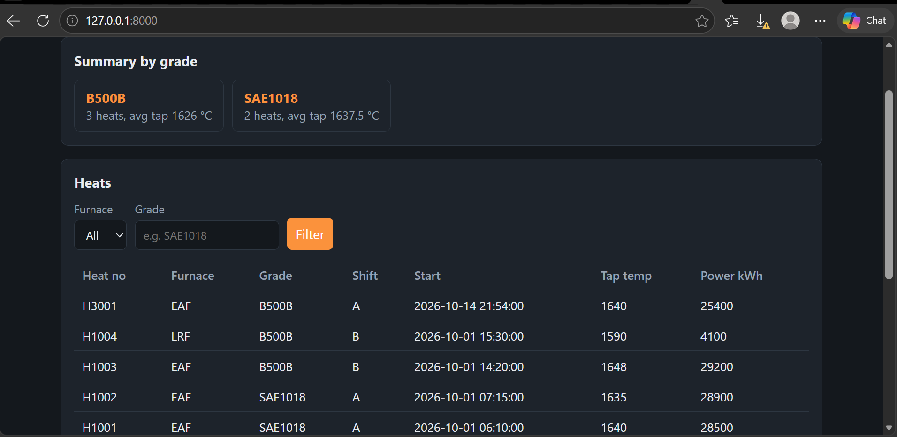

# Heat Records API

A REST API for storing and querying steelmaking heat records (EAF and LRF), built with Python, FastAPI and SQLite. It has a simple web page for browsing and adding heats, and is packaged as a downloadable Windows app.



All data in this repository is **made up** for demonstration. It contains no real plant records.

## What it does

The API stores heats (one batch of steel) and the events recorded during each heat, such as temperature readings and chemistry samples. You can list and filter heats, update them as results come in, and get a summary of heats per grade.

## Features

- List heats with filters: furnace, grade, date range
- Create and update heats (POST, PATCH)
- Attach temperature and chemistry events to a heat
- Input validation, e.g. tap temperature must be between 1400 and 1800 °C
- Duplicate heat numbers are rejected (409 Conflict)
- Summary per grade: number of heats and averages of tap temperature, heat size, power, carbon injection, oxygen and lime
- Web page at `/` with the summary, a filterable heat table, a chart of tap temperature by heat, and forms to add, edit and delete heats (API errors are shown on the page)
- Interactive documentation at `/docs`
- Packaged as a Windows app (`HeatRecordsAPI.exe`) that starts the server and opens the web page

## Download and run (Windows)

1. Download `HeatRecordsAPI.exe` from the [Releases](../../releases) page.
2. Double-click it. The first start can take up to 30 seconds.
3. If Windows shows "Windows protected your PC", click **More info**, then **Run anyway**. This warning appears for any app that is not code-signed.
4. A black window opens (this is the server, keep it open) and your browser opens the web page at http://127.0.0.1:8000/. The API documentation is at http://127.0.0.1:8000/docs.

The app starts with an empty database. Add heats with the form on the page. Close the black window to stop it.

If you used an earlier version, delete the old `heats.db` file next to the app before starting, because the database now has new columns.

## Run from source

Requires Python 3.10 or newer. Commands are for Windows PowerShell.

```
git clone https://github.com/Abdulazeez-abdullahi-dev/heat-records-api.git
cd heat-records-api
python -m venv venv
venv\Scripts\Activate.ps1
pip install -r requirements.txt
python import_csv.py sample_heats.csv
uvicorn main:app --reload
```

Then open http://127.0.0.1:8000/ for the web page, or http://127.0.0.1:8000/docs to try the endpoints.

To build the app yourself:

```
pip install pyinstaller
pyinstaller --onefile --name HeatRecordsAPI --collect-submodules uvicorn launcher.py
```

The result is `dist\HeatRecordsAPI.exe`.

## Endpoints

| Method | Path | Purpose |
|---|---|---|
| GET | / | Web page |
| GET | /heats | List heats (filters: furnace, grade, date_from, date_to) |
| GET | /heats/{heat_no} | One heat with its events |
| POST | /heats | Create a heat |
| PATCH | /heats/{heat_no} | Update only the fields you send |
| POST | /heats/{heat_no}/events | Add a temperature or chemistry event |
| DELETE | /heats/{heat_no} | Delete a heat |
| GET | /summary | Heats and averages per grade (tap temperature, heat size, power, carbon injection, oxygen, lime) |

## Example

`GET /summary` returns one entry per grade (values below are example numbers):

```json
[
  {
    "grade": "SAE1018",
    "heats": 2,
    "avg_tap_temp": 1637.5,
    "avg_heat_size_t": 85.0,
    "avg_power_kwh": 28700.0,
    "avg_carbon_kg": 300.0,
    "avg_oxygen_nm3": 1200.0,
    "avg_lime_kg": 900.0
  }
]
```

A value that has not been entered for any heat of that grade is returned as `null`.

## What I learned

I built this as a beginner, working through it step by step. I learned how an API turns a request into a database query, how POST and PATCH differ, and how status codes (200, 201, 404, 409, 422) describe what happened. I added my own fields with validation limits, wrote a summary endpoint and checked it against a hand calculation, published the project with Git and GitHub, built a web page for it with plain HTML and JavaScript, and packaged it as a Windows app with PyInstaller.

## Possible next steps

- Add API-key authentication
- Move from SQLite to PostgreSQL
